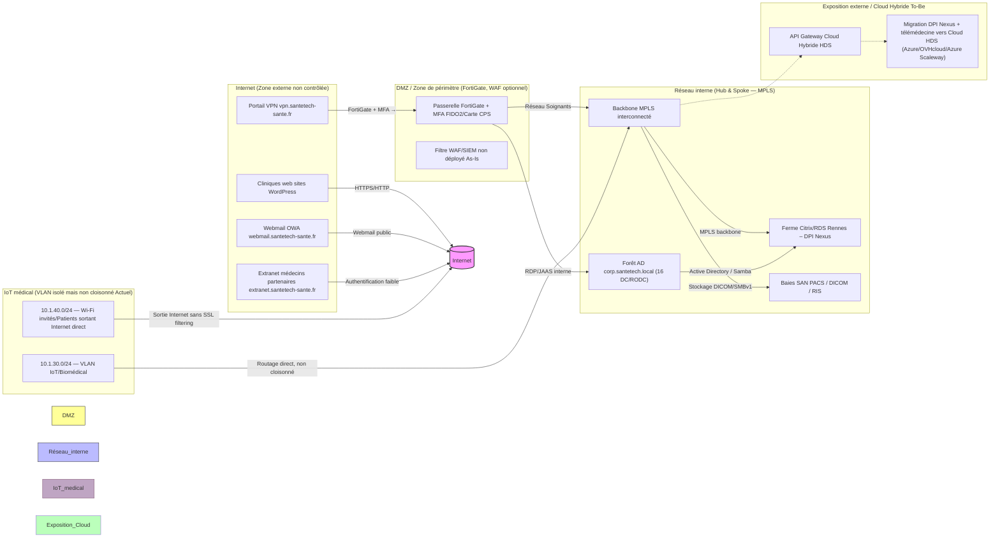

# Analyse E21 — Étape 1 : Description du cas & Cartographie du système (ANSSI-CARTO-SI)

## 📄 1. Résumé de la fiche (cas étudié)

**Cas SanteTech : Étude de Sécurité — Projet SECU‑CLOUD‑HEALTH (M2 Cybersécurité, bloc 1)**

Ce document résume l'architecture **AS-IS** du groupe hospitalier **SanteTech**, les périmètres, les contraintes réglementaires et techniques, ainsi que les hypothèses validées pour l'analyse de risques E21. L'ensemble est ancré dans la méthode de cartographie des systèmes d'information de référence **ANSSI-CARTO-SI** (2018).

| Éléments | Valeurs validées |
|---|---|
| **Secteur / Enjeu** | Santé numérique, migration vers un cloud hybride certifié HDS |
| **Périmètre physique** | Siège social (Rennes) + 12 cliniques régionales (Grand Ouest & Île-de-France) [E10][E224] |
| **Collaborateurs** | ~4 500 personnes : 1 200 médecins, 2 300 soignants, 1 000 administratifs [E204] |
| **Dossiers patients actifs** | 150 000 dossiers dans le DPI Nexus legacy [E19][E223] |
| **Serveurs & applications** | 185 serveurs (65 physiques, 120 virtuels) ; 3 200 postes + ~4 000 dispositifs IoT médicaux [E147][E3][E230] |
| **Contraintes réglementaires** | RGPD, NIS 2, certification HDS, ISO 27001 |
| **Objectif de la mission** | Concevoir une architecture sécurisée (To‑Be) : cloud hybride HDS, microservices, zero trust et API Gateway. Tester la résilience contre ransomwares/fuites [E224] |

---

## 🗺️ 2. Architecture et frontières de confiance (DFD — diagramme des flux)

La figure ci‑dessous représente les vues **métier → applicative → technique** selon la logique de l'ANSSI, avec les frontières de confiance principales :

**Explication des zones (selon la cartographie ANSSI) :**

| Zone | Description | Frontière de confiance |
|------|-------------|------------------------|
| **Internet** | Extérieur non contrôlé, attaques OT/BOT, scanning, phishing. | Interface sortante/entrée directe sans contrôle fort (WAF, SIEM). |
| **DMZ / VPN Gateway** | Point d'entrée principal (vpn.santetech-sante.fr) + OWA. Authentification simple → risque accès non filtré [E7][E203] | FortiGate + login/mot de passe sans MFA sur 60% des comptes (hypothèse validée As‑Is) [E44]. |
| **Réseau interne (Hub & Spoke)** | Backbone MPLS centralisé par le siège. Routage direct entre clinique et siège. Micro‑segmentation absente : un poste compromis peut tout atteindre [E36][E203] | Interne — accès restreint aux identités AD, mais absence de micro‑segmentation VLAN. |
| **VLAN IoT/Biomédical (10.1.30.0/24)** | Dispositifs non patchables : pompes perfusion, moniteurs, scanners. OS temps réel non patchables [E17][E3]. Routage direct vers les automates — absence de NAT/firewall interne entre VLAN IoT et cœur réseau [E9] | Frontière technique : VLAN isolé mais routage direct actif (absence de micro-sgmentation VLAN/NAC). |
| **VLAN Wi‑Fi Invités/Patients (10.1.40.0/24)** | Accès Internet sans filtrage SSL pour la connectivité des patients [E18][E203]. Risque rebond défacement/phishing. | Exposé à Internet, accès libre, sortie non contrôlée. |
| **Cloud hybride To‑Be** | Migration du DPI Nexus vers un cloud certifié HDS (Scaleway/OVHcloud/Azure) + nouvelle API Gateway télémédecine. Contrainte : hébergeur HDS obligatoire [E5][E9] | Frontière hybride contrôlée — accès via API Gateway sécurisée, signature images Docker/SBOM à intégrer. |

---

## 🧭 3. Contexte métier & contraintes (données personnelles = `true`)

### Données personnelles et sensibilité

Ce système traite, stocke et transmet des **données de santé**, données sensibles par nature :

| Type de donnée | Sensibilité | Volume | Préoccupations principales RGPD/NIS 2 |
|---|---|---|---|
| Dossiers patients (DPI Nexus) | Critique / Données à caractère personnel sensibles | 150 000 dossiers actifs [E19] | Accès non autorisé, fuites via RDP/Citrix, fuite de données via API Gateway [E18] |
| Stockage images radiologiques (PACS/RIS) | Critique / Données à caractère personnel sensibles | 150 k dossiers + imagerie DICOM | Protocoles SMBv1 actifs → vulnérabilités non patchées, accès RDP internes [E2][E5] |
| Messagerie sécurisée (Mél) | Sensible / Données personnelles | Exchange 2016 DMZ + Webmail OWA | Vulnérabilités ProxyShell/Spraying, absence de filtrage SSL externe, exposition DMZ [E3][E5] |
| Parc Wi‑Fi Invités/Patients | Publique (accès libre) | 700 PC portables administratifs, 4 500 collaborateurs | Accès Internet direct sans filtrage SSL → fuites potentielles via conteneurs/patients mobiles [E18] |
| Identities AD / Rôles & permissions | Sensible (identifiants/MDP) | Forêt unique corp.santetech.local avec 16 DC/RODC, pas de MFA systématique sur le VPN As‑Is | Authentications faibles, absence de MFA FIDO2/Carte CPS [E45] |

**Champ `donnees_personnelles` = `true`** — L'analyse STRIDE doit donc être complétée par une gride LINDDUN (confidentialité, intégrité, authenticabilité, non‑repudiation) pour les échanges sensibles, notamment via l'API Gateway et les flux DMZ [E8][E9].

### Contraintes réglementaires & exigences techniques

| Référence | Exigence applicable / Impact sur l'analyse |
|---|---|
| **RGPD** | Traitements de données sensibles ; registre de traitement à produire ; droit à l'effacement, limitation de conservation. |
| **NIS 2** | Obligation d'évaluer les risques, SOC centralisé (EDR/SIEM), plans de reprise (PCA/PRA). |
| **HDS (Certification)** | Hébergement dans un cloud certifié HDS (obligatoire pour migration du DPI et télémédecine). Analyse exposition Cloud Act pour souveraineté des données. |
| **PSSI / ISO 27001** | Durcissement des accès, gestion des vulnérabilités (patch management) ; revue de politiques de sécurité (PSSI). |

### Hypothèses techniques (validées + écarts à signaler)

Certaines hypothèses « To‑Be » doivent être traitées comme des éléments non documentés tant qu'aucune preuve n'est disponible :

| Élément | Hypothèse retenue / État actuel | Écarts notables (à valider) |
|---|---|---|
| **Migration DPI Nexus** | Vers Cloud HDS certifié, pas de fournisseur imposé. API Gateway nouvelle brique. | Aucun choix de fournisseur imposé ; analyse Cloud Act obligatoire [E6][E9] |
| **MFA systématique** | Déploiement cible Entra ID / Keycloak avec MFA FIDO2 / Carte CPS pour les soignants [E45]. | As‑Is : pas de MFA sur le VPN → 60% des comptes sans MFA, simple login/mot de passe [E7][E203] |
| **VLAN IoT vs VLAN Wi‑Fi** | Isolation logique stricte (micro‑segmentation) pour la cible To‑Be. Actuellement : routage direct entre automate et cœur réseau, VLAN IoT non cloisonné [E15]. | Écart documenté : fiche FAQ (doc) vs audit technique (fiche d'audit) : les deux documents s'accordent sur l'absence de micro‑segmentation actuelle [E9][E203] |
| **SOC / EDR / SIEM** | Absence initiale des 3 briques SOC centralisé. Projet doit répondre aux exigences NIS 2/RGPD/HDS. | Aucun SOC/EDR/SIEM déployé en As‑Is ; Blue Team & SOC non implémentée [E140][E38] |
| **Postes irréductibles (Windows 7/XP Embedded)** | ~5% du parc (~200 postes) ne peuvent être patchés ou upgradées. Utilisés pour l'imagerie médicale et automates vieux scanners. | Pas de plan de remplacement prévu ; risque vulnérabilité élevée par absence de correctifs [E139] |
| **Postes legacy imagerie** | 200 postes Windows 7/XP Embedded pilotant des vieux automates d'imagerie (pas de patch possible) [E18][E140]. | Risque élevé : vulnérabilités connues non patchables ; dépendance forte à l'application métier PACS/RIS. |
| **Postes portables cadres** | 700 PC portables BitLocker mais sans agent EDR moderne, uniquement antivirus signature ancien [E156]. | Absence d'agent EDR ; vulnérabilités potentielles Ransomware via ports USB ou connexion Wi‑Fi non filtré. |

---

## 📌 4. Actifs « à ne pas oublier » (liste courte pour l'évaluation LINDDUN)

Pour la grille LINDDUN, l'analyse porte prioritairement sur ces éléments sensibles et exposés :

| Actif stratégique | Pourquoi important | Exposition principale |
|---|---|---|
| **API Gateway Cloud Hybride** – Nouvelle brique de télémédecine [E16] | Interface REST/HTTPS entre le cloud HDS et les systèmes clients. Signature SBOM et images Docker doivent être intégrées. | Fuite de données (Linddun‑**L**), usurpation d'identité (A), non-repudiation (NR) si signature API absente. |
| **DPI Nexus Legacy (Citrix/RDS)** – Données patients + 185 serveurs [E1][E25] | Cœur métier du traitement administratif/consommation médicale. | Accès interne via RDP non contrôlé, absence de micro-segmentation, vulnérabilité proxyshell si Exchange exposé. |
| **VLAN IoT/Biomédical (10.1.30.0/24)** – 4 000 dispositifs [E17] | Dispositifs médicaux critiques non patchables : pompes perfusion, moniteurs, scanners. | Risque de contrôle à distance si compromis via botnets (ex. Mirai) ou attaques DoS interne. |
| **VLAN Wi‑Fi Invités/Patients (10.1.40.0/24)** – Accès Internet direct sans SSL filtering [E18] | Exposition directe aux attaquants depuis l'internet pour les patients mobiles. | Attaques pharming/phishing, fuite de données via conteneurs malveillants dans le trafic sortant Wi‑Fi. |
| **Messagerie OWA (webmail.santetech-sante.fr)** – Serveur Exchange 2016 DMZ [E3] | Accès Webmail public et messages cliniques entre professionnels externes/parisiennes. | Attaques Spraying/ProxyShell, accès non filtré SSL, vulnérabilités connues CVE-2024… potentielles si version > 2024. |

---

## 📝 Conclusion de l'étape 1 (cartographie)

La vue **AS‑Is** présente une architecture legacy fortement couplée :
- Un backbone MPLS centralisé mais **sans micro-segmentation**, ce qui fait de chaque clinique un point d'accès potentiel aux serveurs sensibles du siège.
- Des applications métier critiques (DPI Nexus, PACS/RIS) hébergées sur des infrastructures **legacy** avec absence de SOC/EDR/SIEM centralisé.
- Du domaine IoT médical exposé à Internet via VLAN non cloisonné et Wi‑Fi patient, ce qui ouvre la voie à des attaques botnet/ransomware ciblant les automates sensibles.

Le projet SECU‑CLOUD‑HEALTH propose une transformation vers un **cloud hybride HDS** certifié avec :
- Migration du DPI Nexus vers un cloud HDS (choix fournisseur libre : Azure, Scaleway ou OVHcloud).
- Déploiement d'un **IdP centralisé** avec MFA systématique FIDO2 / Carte CPS.
- Nouvelle **API Gateway sécurisée** pour la télémédecine et exposition contrôlée des flux sensibles.

Les écarts de sécurité (absence SOC, VLAN non cloisonné, MFA partiel) doivent être priorisés via une grille LINDDUN + scoring CVSS/CVE pour définir les risques résiduels du To‑Be.