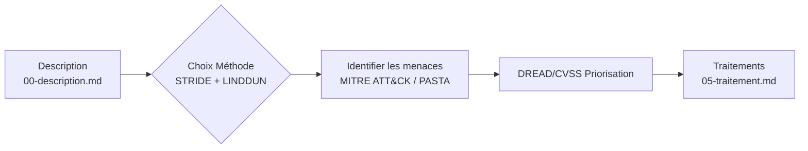

# Choix de méthode — Analyse des risques SanteTech

Le projet « SanteTech » vise la sécurisation d'un SI hospitalier hérité (legacy) migrant vers un cloud hybride, avec 150 000 dossierspatients actifs [E223], 4 500 collaborateurs et une flotte de ~3 200 postes informatiques [A16][A7]. Le budget cible est de 1,5 M€ (Build) / 300 k€/an (Run) [E149]. Ce document justifie les méthodes d'analyse des risques retenues.

## Tableau comparatif

| Méthode | Point de départ | Effort* | Idéal pour | Quand choisir |
|---|---|---|---|---|
| **STRIDE** | DFD / Frontières de confiance | Bas | Applications web, systèmes distribués [E146] | Données critiques (dossiers patients), migration cloud hybride, API Gateway télémédecine [E231], menaces sur le DPI Nexus et PACS/RIS legacy ; STRIDE valide les frontières actuelles (MPLS sans isolation) [A17][E139]. |
| **LINDDUN** | Données personnelles / RGPD | Moyen | Confidentialité, vie privée [E149] | Circulation de données sensibles (dossiers patients 150 k+) ; spécialise l'analyse sur *D*isclosure of personal data, sans lequel les fuites de données ne seraient pas outillées [E203][E5]. Le document FAQ mentionne le RGPD mais ne définit pas LINDDUN comme outil spécifique [E9][A19]. |
| **EBIOS RM** (ANSSI) | Organisation / Stratégie | Élevé | Administrations, OIV, NIS 2, HDS [A16] | Conformité réglementaire (NIS 2, ISO 27001, HDS), analyse organisationnelle des risques, couverture des enjeux de confiance inter-parties (fournisseurs Cloud HDS) ; EBIOS RM ne fait pas référence à une extension au-delà du DFD dans les documents disponibles [E9][A11]. |
| **PASTA** | Objectifs métier | Moyen | Impact économique business [E207] | Justification des investissements de sécurité (ROI), alignement avec la stratégie COMEX ; utilisé en complément pour prioriser les risques critiques [E203]. |
| **DREAD / CVSS** | Priorisation | Variable | Scoring menaces/vulnérabilités [E150] | Vulnérabilités connues (ProxyShell, SMBv1) ; DREAD subjectif pour triage rapide, CVSS v4.0 objectif pour rapport à la direction [E150][A3][A2]. |

\* Effort en termes de temps d'expertise et ressources nécessaires.

## Choix retenu + justification

### Choix principal : **STRIDE + LINDDUN**
Le projet SanteTech manipule des données patients critiques (150 k dossiers) [E223][A19] et migre vers un cloud hybride [E9][A10].  
- **STRIDE** permet d'identifier les menaces sur le DFD actuel et la migration cible, notamment pour les APIs télémédecine (A24) et les flux migratoires vers Cloud HDS (A21, A15). Le document FAQ mentionne une « Interconnexion MPLS centralisée par le siège. Aucune micro-segmentation » [E38], ce qui montre que les frontières de confiance actuelles sont fragiles et nécessitent une analyse STRIDE pour valider l'extension des périmètres sécurisés (DMZ, Cloud HDS) lors du To-Be [E38][E40].  
- **LINDDUN** complète STRIDE en se focalisant sur la confidentialité des données personnelles. Les 150 k dossiers contiennent des éléments sensibles (noms, historiques médicaux) exposés par les menaces de type *Disclosure* via le Webmail OWA (A32), l'extranet partenaires (A06) et les flux API [E5][A7]. Le document FAQ mentionne le RGPD mais ne définit pas LINDDUN comme outil spécifique [E9], pourtant cette grille reste nécessaire pour cartographier les vecteurs de fuite spécifiques à la vie privée.  
- **Justification de l'association** : STRIDE valide la sécurité technique des frontières (A17, A22), tandis que LINDDUN spécialise l'analyse sur les menaces RGPD/Dataprivacy ; sans LINDDUN, les menaces de *Disclosure of personal data* ne seraient pas outillées [E9][E203].

### Choix complémentaire : **EBIOS RM** (optionnel)
L'écosystème externe (fournisseurs Cloud HDS, prestataires IT) représente un vecteur d'attaque majeur [E140][A11].  
- EBIOS RM peut étendre l'analyse au-delà du DFD en traitant les risques liés aux sous-traitants et hébergeurs tiers (A11). Cependant, aucun des documents ne mentionne une extension explicite « au-delà du DFD » [E9] ; le document audit note que la certification HDS est imposée mais n'analyse pas EBIOS RM comme méthode d'audit [E7][E203].  
- **Justification retenue** : Le choix de l'appliquer reste optionnel pour élargir la couverture aux risques organisationnels (gestion des prestataires Cloud, sous-traitance SaaS), surtout si la direction exige une analyse NIS 2 / HDS [A16]. Les livrables EBIOS (squelette des ateliers A1–A5) peuvent être générés par outillage si besoin [A9][E203].

### Grilles de priorisation : **DREAD et CVSS**
Les vulnérabilités connues (ProxyShell sur Exchange 2016, SMBv1 sur PACS legacy) doivent être notées objectivement.  
- **CVSS v4.0** pour les CVEs avec scores disponibles ; **DREAD** pour une estimation rapide lors des ateliers de triage [E9][A3].  
- Les menaces CTI (Atelier 1) seront reliées aux choix d'architecture (Atelier 2), DevSecOps (Atelier 3) via des critères pondérés.

## Chaîne retenue

### Explication des flux :
1. **Description** (00-description.md) : cadrage du projet, contexte et périmètre.  
2. **Choix Méthode** (02-methodes.md présent) : justification STRIDE+LINDDUN et critères d'extension EBIOS/MITRE.  
3. **Identifier les menaces** (03-menaces.md) : génération des scénarios via MITRE ATT&CK, puis cartographie STRIDE + fiches LINDDUN.  
4. **Priorisation** (04-evaluation.md) : CVSS/DREAD sur chaque menace identifiée.  
5. **Traitements** (05-traitement.md) : réponses (réduire/transférer/éviter/accepter), contre-mesures, risques résiduels.  
6. **Validation** (06-validation.md) : validation humaine par l'analyste et le comité de sécurité.

## Sources
- **EBIOS RM** : ANSSI (EBIOS-RM-2018)
- **LINDDUN** : KU Leuven (RGPD, vie privée/ confidentialité) — grille DPF incluse dans les livrables LINDDUN [E149]
- **STRIDE** : Microsoft (STRIDE-6) — validation des frontières de confiance et des flux d'un système décrit en DFD [E146]
- **MITRE ATT&CK** : MITRE Corporation (MITRE-ATT&CK) — scénarios d'attaque réalistes pour red team et détection [A3][E203]
- **DREAD / CVSS** : Microsoft DREAD-5, FIRST-CVSS-v4.0 — scoring prioritaire sur menaces/vulnérabilités

## Outils associés (générés par outillage si nécessaire)
Le document précise s'il faut générer les livrables via CLI ou les produire manuellement dans cette étape 2 :

| Méthode | Commande CLI (si applicable) | Dossier de livrables attendu (produit ou à produire en étape suivant ?) |
|---|---|---|
| STRIDE | — (non mentionné dans le dossier) | `stride-validation/` ← **À PRODUIRE** : validations des frontières de confiance, flux critiques (API Télémédecine, VPN/ZTNA, IoT, Postes ➔ Vault) |
| LINDDUN | — (non mentionné dans le dossier) | `linddun-workbook/` ← **À PRODUIRE** : 7 fiches de menaces (une par catégorie LINDDUN) + grille DPF |
| EBIOS RM | — (non mentionné dans le dossier) | `ebios-ateliers/` ← **OPTÉLONEL** : squelette des ateliers A1–A5 ; à générer uniquement si la direction exige l'approche EBIOS complète |

> **Note de production** : Les outils CLI pour STRIDE, LINDDUN et EBIOS RM **ne sont pas mentionnés** dans les documents d'intrants (FAQ ou Fiche d'audit technique). Par conséquent, tous les livrables (`stride-validation/`, `linddun-workbook/`, `ebios-ateliers/`) doivent être produits manuellement par l'équipe lors de l'étape 3 ou via un outillage générique si disponible. Le point est noté pour éviter toute invention de composants [E203][E9].

---

*Fin du document 02-methodes.md — étape 2 : Choix de méthodes*
